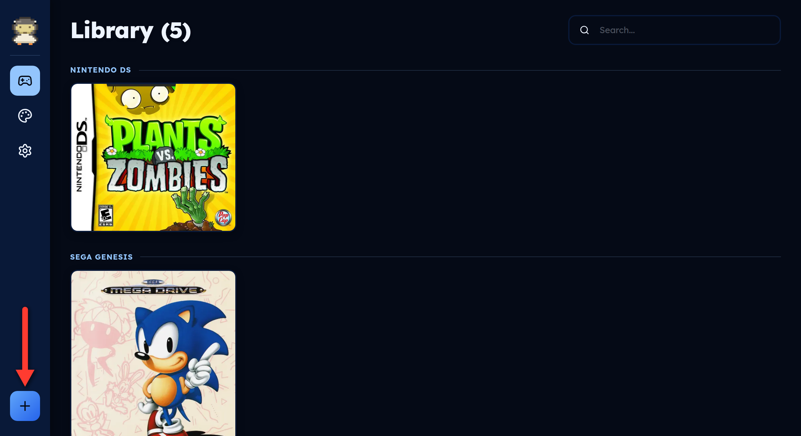
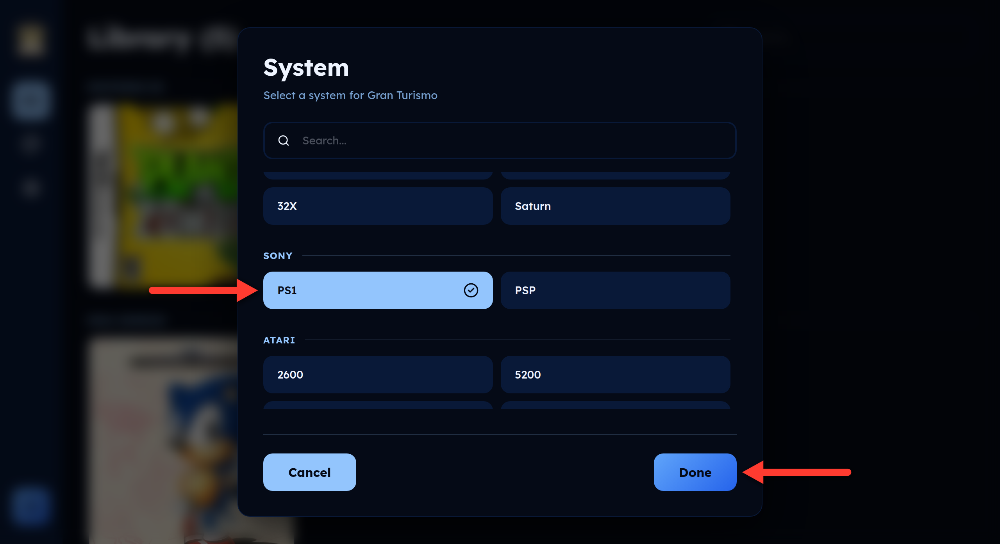
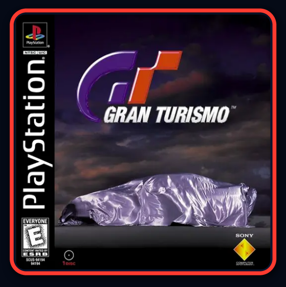
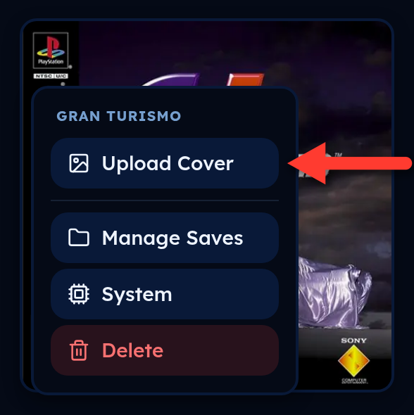
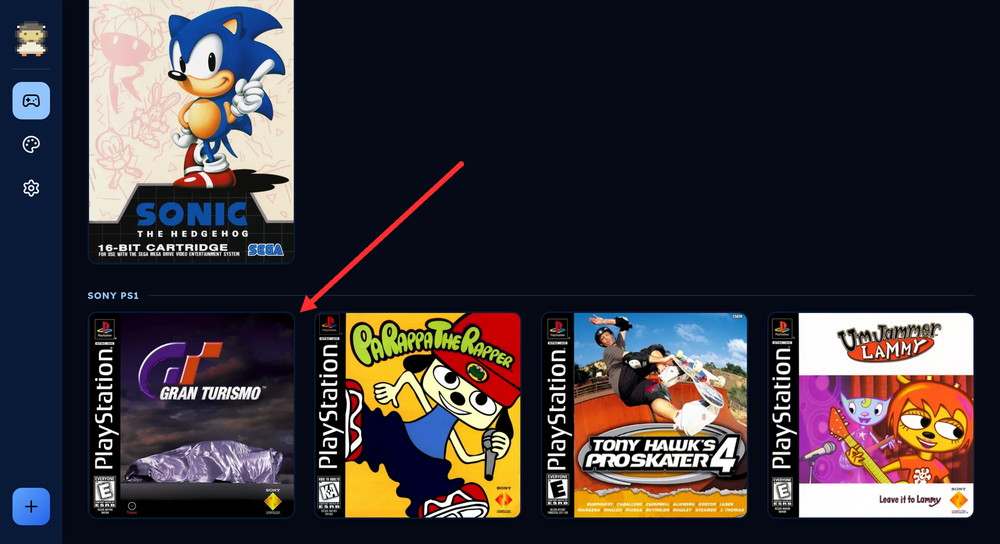

<h1>JOE T EMULATOR</h1>

<a href="https://joetemulator.netlify.app">joetemulator.netlify.app</a>

## Features

- **30+ supported systems**
- **Auto cover art** - Fetched from the [libretro-thumbnails](https://github.com/libretro-thumbnails) GitHub repos based on hashing or the game title as a fallback
- **Completely local** - All ROMs and save states stay in your browser
- **RetroAchievements** - Earn [achievements](https://retroachievements.org) while you play, with an optional hardcore mode

## Supported Systems

| Manufacturer | Systems |
|---|---|
| Nintendo | NES, SNES, N64, Game Boy, GBC, GBA, DS, Virtual Boy |
| Sega | Master System, Genesis, Game Gear, CD, 32X, Saturn |
| Sony | PlayStation, PSP |
| Atari | 2600, 5200, 7800, Lynx, Jaguar |
| Commodore | Amiga, 64, 128, VIC-20, Plus/4, PET |
| NEC | TurboGrafx-16, PC-FX |
| Arcade | FBNeo, M.A.M.E. |
| Other | 3DO, DOS, ColecoVision, Neo Geo Pocket, WonderSwan, Intellivision |

## Adding Games

1. Click the **+** button at the bottom of the sidebar and choose one or more game files. You can also drag and drop files anywhere on the page.

2. If the system can't be detected from the file type (for example, a `.bin` disc image), choose the system and click **Done**.

3. Cover art is added automatically. To use your own image instead, right-click the game and choose **Upload Cover**.

  
  

4. Click a game to start playing.

## RetroAchievements

1. Open **Settings**, turn on **RetroAchievements**, then click **Log In** and sign in with your [RetroAchievements](https://retroachievements.org) account.

2. Start a game. Achievements unlock automatically as you play.

3. To see a game's achievements, open **Game Settings** while playing and go to the **Achievements** tab, or right-click the game in your library and choose **Achievements**.

**Hardcore Mode** (also in Settings) is for players who want a tougher challenge. While it's on, you can't load save states, pausing is limited, and some core options are blocked.
